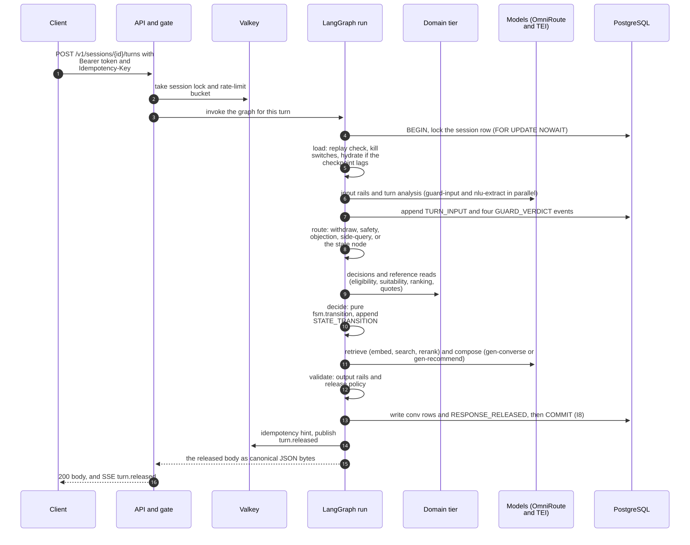

# Architecture

How SurakshaSetu fits together: the tiers and what runs where, one turn from request to release, the model path, and the repository layout. The state machine, the data and audit design, and each subsystem have their own documents: [state-machine](state-machine.md), [data-and-audit](data-and-audit.md), [subsystems](subsystems.md). Start with the [overview](overview.md) if the product is new to you.

## System context



Three boundaries matter more than the boxes:

1. **The model boundary.** The orchestrator names a _route_ and a _data class_ (`guard-input`, `nlu-extract`, `gen-converse`, `gen-recommend`, `verify-claims`, `summarise`), never a model or provider. OmniRoute is the only egress for chat models. Embedding and reranking go straight to the self-hosted TEI servers so customer query text never leaves the network.
2. **The decision boundary.** Every decision that involves a number or a rule comes from the Java tier. The model has no tool access to it. The Python tier only calls it from deterministic state-node code, and never before valid consent (I1), apart from two reference reads at session creation.
3. **The trust boundary around personal data.** Raw customer text exists only (a) in process memory; (b) encrypted under the subject's key in `conv.turn`, `conv.slot_value` and the audit payloads; (c) in the LangGraph checkpoint, which holds the session state and is removed by the erasure hard-delete; and (d) in calls to the self-hosted-only routes (`guard-input`, `nlu-extract`, `verify-claims`, `summarise`). Everything else (logs, audit headers, the generation routes, the advisor briefing) sees redacted or tokenised text.

## Technology stack at a glance

| Layer                   | Choices                                                                                                    | Role                                                                            |
| ----------------------- | ---------------------------------------------------------------------------------------------------------- | ------------------------------------------------------------------------------- |
| Conversation tier       | Python, FastAPI, Pydantic v2, LangGraph with a Postgres checkpointer, SSE                                  | Conversation API, one graph run per turn, rails, composer, retrieval, audit     |
| Domain tier             | Java, Spring Boot, embedded Apache KIE DMN, OpenAPI 3.1                                                    | Consent, catalogue, disclosures, eligibility, suitability, ranking, quotes      |
| Chat client             | React, Vite, TypeScript (strict), vitest, Playwright                                                       | Thin client that renders server-sent parts                                      |
| Model path              | OmniRoute (OpenAI-compatible); TEI serving BGE-M3 (embed) and gte-multilingual (rerank)                    | Chat models by route name only; embedding and reranking stay self-hosted        |
| Retrieval and ingestion | Qdrant (dense + BM25 sparse, RRF fusion); Docling, Dagster                                                 | Cited evidence from review-gated, immutable corpus snapshots                    |
| Data                    | PostgreSQL, Valkey, MinIO (object lock)                                                                    | System of record; locks, rate limits, pub/sub; WORM audit anchors               |
| Privacy and integrity   | Presidio and spaCy, AES-256-GCM per-subject keys, RFC 8785 JCS hashing, Ed25519                            | PII redaction, erasure by key destruction, reproducible hashes, signed hand-off |
| Tooling and quality     | Docker Compose, Flyway, uv, Maven wrapper, npm; pytest, Hypothesis, Schemathesis, Testcontainers, ArchUnit | Local stack, migrations and builds; property, contract and architecture tests   |

Pinned versions, ports and per-component responsibilities are in the [component catalogue](#component-catalogue); what each library is for is in [dependencies and their roles](#dependencies-and-their-roles).

## Component catalogue

| Component                                | Technology (pinned)                                                        | Port                              | Responsibility                                                                                                                                             |
| ---------------------------------------- | -------------------------------------------------------------------------- | --------------------------------- | ---------------------------------------------------------------------------------------------------------------------------------------------------------- |
| **Chat client**                          | React 19.3.0, Vite 8.3.4, TypeScript 5.9.3                                 | 5173 (dev server)                 | Thin client: renders server-sent parts, sends typed text or a quick reply's own action, holds the token in memory only                                     |
| **Orchestrator** (`orchestrator/`)       | Python 3.12, FastAPI 0.141.1, LangGraph 1.2.12, uvicorn 0.53               | 8000                              | Conversation API (sessions, turns, SSE, internal audit, hand-off and kill-switch endpoints), one LangGraph run per turn, rails, composer, retrieval, audit |
| **Scheduler**                            | Same image, `python -m surakshasetu.jobs.timers --every 60`                | none                              | Pauses post-consent sessions idle past their state's timeout (600 s by default)                                                                            |
| **Domain services** (`domain-services/`) | Java 21, Spring Boot 4.1.1, embedded Apache KIE DMN 10.2.0                 | 8080                              | Consent Service, Product Catalog, Disclosure Registry, reference data, eligibility, suitability, ranking, quote adapter                                    |
| **Gateway**                              | OmniRoute 3.8.50, pinned by image digest                                   | 20130 (admin UI on the same port) | Stateless egress to the chat models; hardened, configured from Git (`infra/omniroute/seed.json`)                                                           |
| **Stubs** (`tools/stubs/`)               | FastAPI                                                                    | 8090                              | An OpenAI-compatible scriptable model stub and the stand-in application journey                                                                            |
| **TEI embed**                            | text-embeddings-inference 1.9.4 (`cpu-arm64`), BAAI/bge-m3 @ `5617a9f6`    | 8081                              | 1,024-dimension multilingual embeddings                                                                                                                    |
| **TEI rerank**                           | Same image, Alibaba-NLP/gte-multilingual-reranker-base @ `8215cf04`        | 8082                              | Cross-encoder reranking                                                                                                                                    |
| **Qdrant**                               | v1.19.1                                                                    | 6333, 6334                        | Dense `dense` + sparse `bm25` vectors per collection                                                                                                       |
| **PostgreSQL**                           | 16.15, `wal_level=logical`                                                 | 5432                              | System of record: `conv`, `consent`, `catalog`, `audit`, `keyvault`, `langgraph`                                                                           |
| **Valkey**                               | 9.1.2 (Redis-compatible)                                                   | 6379                              | Session lock, rate limits, idempotency hints, SSE pub/sub                                                                                                  |
| **MinIO**                                | Built from pinned source `RELEASE.2025-09-07T16-13-09Z`                    | 9000                              | WORM buckets `audit-anchors` and `audit-archive` (object lock enforced at start)                                                                           |
| **Flyway**                               | 12.4.0                                                                     | one-shot                          | Applies `infra/db/migrations` V1–V8                                                                                                                        |
| **Ingestion**                            | Dagster 1.13.24, Docling 2.131.0 (host process, `ingest` dependency group) | none                              | Review-gated KB ingestion into immutable Qdrant snapshots                                                                                                  |

## Turn lifecycle

Every customer message, button press or timer tick is one **turn**. The design target is a p95 of 2.5 s for S1–S2 and 6.5 s for S3, with S3 released whole and never token-streamed.

| #   | Stage                                                                                             | p95 budget                                         |
| --- | ------------------------------------------------------------------------------------------------- | -------------------------------------------------- |
| 1   | Session load, authentication, rate limit, idempotency                                             | 30 ms                                              |
| 2   | Input rails (150 ms) with turn analysis running concurrently (600 ms; discarded if a rail blocks) | 150 ms / 600 ms                                    |
| 3   | Transition function and domain-service calls                                                      | 300 ms                                             |
| 4   | Retrieval                                                                                         | 350 ms                                             |
| 5   | Composition: template, or cited generation                                                        | 1.2 s (`gen-converse`) / 4 s (`gen-recommend`)     |
| 6   | Output rails                                                                                      | 150 ms deterministic / 800 ms with `verify-claims` |
| 7   | Commit the checkpoint and audit records, **then** release                                         | 50 ms                                              |



How the build realises this lifecycle:

- **The API takes the lock and the rate limit before the graph runs** (`lock:session:{id}` via `SET NX PX`, released by a Lua compare-and-delete; `rl:{subject_ref}:{window}:{bucket}`). LangGraph's `durability="exit"` writes a checkpoint even when a node refuses, so a refused concurrent turn must never reach it. Redis down fails closed.
- **One database transaction spans `load` to `commit`.** `analyse_turn`, `decide` and the output rails append audit events in that transaction; `commit` writes the conversation rows and `RESPONSE_RELEASED` and commits. Any failure before it rolls everything back (HTTP 503) and a retry with the same `Idempotency-Key` is safe. The release (the HTTP body and the SSE event) happens only after the commit: **invariant I8**.
- **The LangGraph checkpoint is written after the commit**, once per turn. If the checkpoint ever lags `conv.turn`, the next turn **hydrates** the session from the official records (`conv.session` plus the consent record) and logs a warning. Engine payloads are recomputed, never hydrated.
- **Replays are byte-identical.** A retried `Idempotency-Key` finds the original out-turn and returns its stored `RESPONSE_RELEASED` payload, even if Redis lost its hint.
- **Only the `commit` node returns a state update** (`{session, committed_seq}`). Every other node works on a `Turn` object (the runtime context, never checkpointed).

## The LangGraph turn graph

There is one `StateGraph` (`graph/nodes.py::build_graph`): **32 nodes and 30 static edges**, compiled with an `AsyncPostgresSaver` (`thread_id = session_id`). The "side-query subgraph" is an ordinary function (`graph/side_query.py::respond`), not a second LangGraph.



- `load` locks the session row, checks for a replay, applies kill switches (an active `prompt_bundle` switch re-pins the session) and hydrates if needed.
- `input` runs the four input rails and the turn analysis ([subsystems](subsystems.md#input-rails-and-turn-analysis)).
- `route` (`turn_router`, TDD §2.6) picks, in order: a withdrawal (the `META_WITHDRAW` intent or the `ERASE` action; **the first check, I5**), a safety signal, an objection, a side question (while the frame stack is below `SS_SIDE_QUERY_MAX_STACK`), else the node of the session's current state.
- Each state node is wrapped by `guarded()`: a domain timeout, unreachable tier or 5xx sets `turn.degraded` so the turn answers from a template instead of failing.
- `decide` builds `Facts`, calls the pure `fsm.transition`, appends `STATE_TRANSITION` (row id, reason code), and chooses the next node. When an FAQ or objection row wins, the turn is decided again without them, and an earned move (for example a confirmed read-back) takes precedence while the answer still leads.
- `compose` selects the released text (a template, a handler's parts, or the state's render); `validate` runs the output rails and the release policy; `commit` and `release` finish the turn as described above.

## Model path and the hardened gateway

**Routes and data classes** (`gateway/adapter.py`; budgets from TDD §1.5):

| Route              | Purpose                                                        | Data class                               | Budget          |
| ------------------ | -------------------------------------------------------------- | ---------------------------------------- | --------------- |
| `guard-input`      | One classifier call answering both injection and safety        | `SELF_HOSTED_RAW`                        | 200 ms          |
| `nlu-extract`      | Turn analysis: intents and slot candidates with evidence spans | `SELF_HOSTED_RAW` (sees raw PII)         | 800 ms          |
| `gen-converse`     | One friendly lead sentence before a template question (S1, S2) | `REDACTED`                               | 2 s             |
| `gen-recommend`    | Cited narrative for S3 and side-query answers                  | `REDACTED`                               | 6 s             |
| `verify-claims`    | Claim-level NLI per cited sentence                             | `SELF_HOSTED_RAW`                        | 1 s             |
| `summarise`        | Rolling summary every 6 turns                                  | `SELF_HOSTED_RAW`                        | 1 s             |
| `embed` / `rerank` | Query embedding and reranking                                  | direct to TEI, never through the gateway | 150 ms / 300 ms |

**Policies enforced client-side before any I/O.** `SELF_HOSTED_RAW` only on self-hosted routes. A `REDACTED` call needs a `RedactionAttestation(sha256_hex(messages))`, issued only by the envelope builder after a clean PII scan; any other hash is refused. Failures raise `GatewayUnavailable(reason, status)` with reasons `TIMEOUT`, `UNAVAILABLE`, `HTTP_ERROR`, `MALFORMED_RESPONSE`, `SCHEMA_MISMATCH`; policy violations (`DATA_CLASS_DENIED`, `ATTESTATION_MISSING`, `ATTESTATION_MISMATCH`, `COMPRESSION_APPLIED`) are a subclass, so template fallbacks cover them. **Nothing retries.** A response whose `x-omniroute-compression` header shows compression fired is rejected. `test_no_model_names.py` fails the build on any model or provider name anywhere in `src/`, so swapping OmniRoute for LiteLLM or Envoy AI Gateway changes only the adapter's base URL.

**SurakshaSetu runs its own OmniRoute** (decision D3, amended 2026-09-28): `diegosouzapw/omniroute:3.8.50` pinned by image digest, compose profile `gateway`, bound to `127.0.0.1:20130`. An earlier general-purpose OmniRoute instance failed several of the hardening rows in TDD §1.6 (it listened on all interfaces, did not require an API key, used a floating tag, and had semantic cache and call logging on), so this project does not use it. Configuration lives only in Git: `infra/omniroute/seed.json` (six `priority` combos with `maxRetries: 0`, one `vllm` connection to the stub, one restricted app key) is applied through the admin API by `orchestrator/scripts/omniroute_seed.py` and **read back**, because the gateway silently drops unknown settings with a 200. `make gateway-verify` exits 1 on any drift.

[`infra/omniroute/HARDENING.md`](../infra/omniroute/HARDENING.md) maps every hardening row (the 11 in TDD §1.6 plus 5 added) to a test and lists the deployment gates that cannot be tested locally: network egress allow-listing, SSO in front of the admin surface, the high-availability model and real secrets.

## The signed hand-off to the application journey

When a customer has chosen a plan with a valid quote and acknowledged its disclosures, row S3.4 moves the session to `HANDOFF` (V7). `handoff/intake.py` builds the TDD §7.1 intake payload (rupees as integers, the selected quote's cover, term, PPT and rider premiums, the shown disclosure and document **hashes** rather than copies, and `audit_anchor` = the session chain's tail), signs it with Ed25519 over its JCS bytes (`SS_INTAKE_SIGNING_KEY_B64`) and POSTs it to `SS_JOURNEY_URL` (2 s, no retry). `tools/stubs/journey.py` verifies the signature (401 on a bad one), answers 201 `{intake_ref}` and treats a repeat of the same `(session_id, quote_id)` as 409 with the first reference (a replay counts as accepted). The decision is recorded as a `conv.handoff` row (queue `application`, reason `APPLICATION_INTAKE`) plus a `HANDOFF` audit event. If the journey is down, the session stays in S3 with an `INTAKE_PENDING` row holding the signed intake for a retry, and (with P2 consent) an advisor hand-off is offered instead.

## The chat client

`frontend/` is deliberately thin: everything shown comes from a released turn (`message.parts` in order, or `message.text` when `parts` is empty) or a quick reply's own label, and everything sent is typed text or a quick reply's `action`, unchanged. There is no business logic, no legal text and no hashing in the browser.

- `src/client.ts` is the only module that talks to the API: `createSession`, `sendTurn`, `deleteSession` and a `fetch`-based SSE reader (EventSource cannot send an Authorization header). It refuses a session body whose `events_url` is not the session's own events path, so the token goes nowhere else.
- `src/Chat.tsx` renders parts by id: `option_card:` as cards, `comparison` as a table, `disclosures:` as always-open sections (never collapsed, clamped or truncated; tests scan the CSS), `sources` as a panel, and anything else, unknown ids included, as a paragraph. The S0 consent form is rendered only from the server's `form` with nothing pre-ticked. The token lives in a `useRef` only (never a URL, storage or log).
- A closed state turns text input off and offers a new conversation, but the latest reply's quick replies stay enabled. An "Erase my data" control with a confirmation sends `DELETE /v1/sessions/{id}`.
- `src/Inspector.tsx` (state, row and reason per turn, from the audit headers) is **dev-only**: it renders only when `import.meta.env.DEV && VITE_INSPECTOR === "1"`, the compliance key is added by the Vite dev proxy and never reaches the browser, and `src/build.test.ts` builds the product with the inspector on and a sentinel key and fails if either appears in the bundle.

## Deployment topology

Everything runs on one machine under Docker Compose (`infra/compose.yaml`, project `surakshasetu`, every port bound to `127.0.0.1`).

| Compose profile | Started by                                  | Services                                                                                                                                                                                 |
| --------------- | ------------------------------------------- | ---------------------------------------------------------------------------------------------------------------------------------------------------------------------------------------- |
| `core`          | `make up`                                   | `postgres`, `valkey`, `qdrant`, `minio`, `minio-init` (one-shot, fails unless both buckets have object lock), `flyway` (one-shot), `domain-services`, `tei-embed`, `tei-rerank`, `stubs` |
| `gateway`       | `make gateway-up`                           | `omniroute`                                                                                                                                                                              |
| `app`           | `make app-up`                               | `orchestrator` (:8000) and `scheduler` (same image)                                                                                                                                      |
| `bakeoff`       | `make bakeoff-embed`, `make bakeoff-rerank` | `tei-embed-challenger` (:8083, Qwen3-Embedding-0.6B), `tei-rerank-challenger` (:8084, bge-reranker-v2-m3)                                                                                |

Named volumes: `pgdata`, `qdrant`, `qdrant-snapshots`, `minio`, `tei-models` (about 2.9 GB of pinned model weights), `omniroute-data`. The orchestrator can run on the host (`make serve`) or in compose (`make app-up`), never both, because both bind port 8000. Liveness and readiness are described in [operations](operations.md#health-and-readiness).

## Repository layout and code map

A monorepo with two product tiers, a UI, contracts, content and infrastructure.

```text
SurakshaSetu/
├── README.md  RELEASING.md  CODEOWNERS  Makefile   front door, release process, owners, the single entry point (CI runs the same targets)
├── assets/images/state-flow.png                     state-flow diagram shown in the overview
├── contracts/openapi/
│   ├── domain-services.v1.yaml                      OpenAPI 3.1: orchestrator <-> domain tier (23 operations, 9 tags)
│   └── conversation-api.v1.yaml                     OpenAPI 3.1, hand-written: chat clients <-> orchestrator
├── orchestrator/                                    conversation tier (Python 3.12, uv project, package surakshasetu)
├── domain-services/                                 domain tier (Java 21, Spring Boot, Maven wrapper)
├── frontend/                                        chat UI (Vite, React, TypeScript strict, npm, Node 24)
├── tools/stubs/                                     stand-ins: scriptable model stub, application-journey stub
├── infra/                                           compose.yaml, Flyway migrations, OmniRoute seed, MinIO build
├── content/                                         versioned, owner-assigned content (prompts, lexicons, seeds, goldens)
└── documentation/                                   this documentation
```

### orchestrator/

```text
orchestrator/
├── pyproject.toml  uv.lock  Dockerfile  .dockerignore  .env.example  scripts/
│   ├── chat.py                    demo terminal client (numbered quick replies)
│   └── omniroute_seed.py          applies and verifies infra/omniroute/seed.json
├── src/surakshasetu/
│   ├── config.py                  Settings (SS_ prefix; 56 fields; pilot/prod fail fast)
│   ├── logging.py  uuid7.py
│   ├── api/        app.py (create_app, /healthz, /readyz, problem handlers) · routes.py (Conversation API)
│   ├── graph/      nodes.py (build_graph) · runtime.py · state.py · facts.py · gate.py (Redis)
│   │               side_query.py · checkpointer_setup.py
│   │   ├── states/     s0.py · s1.py · quote_only.py · s2.py · s3.py
│   │   └── handlers/   data_erasure · human_escalation · pause · safety · identity · objection
│   ├── fsm/        states.py · facts.py · rows.py · transition.py · mermaid.py     (pure, no I/O)
│   ├── analysis/   pipeline.py · nlu.py · normalisers.py · models.py
│   ├── rails/      normalise · redact · injection · safety · output
│   ├── retrieval/  service.py · routing.py · rewrite.py · gate.py · bm25.py
│   ├── kb/         chunker.py · payload.py · manifest.py · golden.py        (pure half of ingestion)
│   ├── compose/    bundle.py · envelope.py · placeholders.py · citations.py · composer.py
│   ├── gateway/    adapter.py                                     (the only model path)
│   ├── domain/     client.py (async DomainClient) · models.py (generated, never hand-edited)
│   ├── store/      conv.py                                        (all conversation-tier SQL)
│   ├── audit/      chain.py · events.py · anchor.py · verify.py · dossier.py
│   ├── crypto/     jcs.py (the only way to hash JSON) · envelope.py · keys.py
│   ├── handoff/    intake.py                                      (signed TDD §7.1 payload)
│   ├── jobs/       timers.py                                      (inactivity timers)
│   └── eval/       metrics.py · labels.py · qa.py · report.py · retrieval_metrics.py · __main__.py
├── src/surakshasetu_ingest/       Dagster/Docling half: assets.py · verify.py · bakeoff.py · __main__.py
└── tests/
    ├── unit/ (69 files)  integration/ (9, marker db)  stack/ (7, marker stack)
    ├── property/ (3)     golden/ (3 modules + harness.py, play.py, redteam.py)   ingest/ (2)
    └── conftest.py · contract_support.py · runtime_support.py
```

### domain-services/

```text
domain-services/
├── pom.xml  mvnw  Dockerfile  .gitattributes
└── src/
    ├── main/java/com/surakshasetu/domain/
    │   ├── DomainServicesApplication.java
    │   ├── common/        Jcs · RawJson · Rules · ServiceAuth · ProblemHandler · Problems · JsonInput
    │   │                  Uuid7 · BusinessDates · CatalogLoaderDb · MetaController · NotImplementedStubs
    │   ├── consent/       ConsentController
    │   ├── catalog/       CatalogController · CatalogRepository · SeedLoader
    │   ├── disclosure/    DisclosureController
    │   ├── reference/     ReferenceController
    │   ├── eligibility/   EligibilityController
    │   ├── suitability/   SuitabilityController · SuitabilityCalculator
    │   ├── ranking/       RankingController · Ranker
    │   └── quote/         QuotesController · QuoteAdapter · RatingEngine (port) · StubRatingEngine
    ├── main/resources/
    │   ├── application.properties
    │   ├── dmn/           eligibility-2026.09.1.dmn (17 rules) · suitability-2026.09.1.dmn (52 rules)
    │   ├── params/        actuarial-2026.09.1.yaml
    │   ├── ranking/       weights-2026.09.1.yaml
    │   └── rating/        dummy-rates-2026.09.1.yaml
    └── test/java/         24 *Test + 2 *IT + DomainApiTestSupport (one Testcontainers Postgres per JVM)
```

### frontend/

```text
frontend/
├── package.json  .nvmrc (24)  .npmrc (engine-strict, save-exact, ignore-scripts)
├── vite.config.ts  tsconfig.json  eslint.config.js  playwright.config.ts  .env.example
├── index.html                 lang="en-IN"
├── e2e/smoke.e2e.ts           Playwright: the scripted customer to HANDOFF in Chromium
└── src/
    ├── main.tsx · Chat.tsx (522) · client.ts (168) · Inspector.tsx (76, dev only) · index.css
    ├── conversation-api.ts    GENERATED from the spec by openapi-typescript; never edited
    ├── fixtures.ts            real released bodies captured from the API (test-only)
    ├── test-support.ts · test-setup.ts (fails any test that calls a console method)
    └── *.test.ts(x)           11 files, 85 vitest cases
```

### content/: content as versioned artefacts

| Path                                                      | What                                                                                                                                                                                                                   | Owner role (CODEOWNERS comment) |
| --------------------------------------------------------- | ---------------------------------------------------------------------------------------------------------------------------------------------------------------------------------------------------------------------- | ------------------------------- |
| `prompt-bundles/pb-2026.09.1` … `pb-2026.10.8`            | Hash-locked prompt bundles (9 versions, all `is_dummy: true`)                                                                                                                                                          | compliance, product owner       |
| `lexicon/output-lexicon-2026.09.1.yaml`, `2026.10.1.yaml` | Output guardrail packs (20 rules each)                                                                                                                                                                                 | compliance                      |
| `faq/privacy-en-IN.yaml`, `privacy-hi-IN.yaml`            | Approved privacy FAQ (7 entries each, DUMMY) used by S0's side-queries                                                                                                                                                 | compliance with the DPO         |
| `seed/catalog/`, `seed/consent/`                          | Fictitious catalogue, disclosure sets, reference data, consent notices                                                                                                                                                 | product, compliance             |
| `seed/kb/`                                                | DUMMY KB corpus: 35 markdown documents (18 product, 8 regulatory, 9 tax) plus `review-manifest.yaml`                                                                                                                   | compliance                      |
| `kb/`                                                     | Retrieval config: `aliases.yaml`, `lexicon.yaml`, `routing.yaml`, `thresholds.yaml` (written only by `make calibrate-retrieval`)                                                                                       |                                 |
| `golden/conversations/<suite>/`                           | 187 conversations in 10 suites (`core` 22, `matrix` 44, `objection` 9, `quote_only` 21, `s0` 19, `s1` 19, `s2` 16, `s3` 20, `side_query` 12, `timers` 5) plus `scripted_s0_s3.yaml`; `preludes/` has 4 shared openings |                                 |
| `golden/slots/`, `golden/intents/`                        | 221 labelled utterances; 174 labelled turns                                                                                                                                                                            |                                 |
| `golden/retrieval/`, `golden/unanswerable.yaml`           | 3 × 20 answerable questions; 10 unanswerable                                                                                                                                                                           |                                 |
| `redteam/`                                                | 6 files, 19 conversations, 157 attack turns, 22 categories, in en, hi and hi-Latn                                                                                                                                      | compliance                      |
| `eval/waivers.yaml`                                       | 4 gate waivers (regulatory and tax recall and precision)                                                                                                                                                               | compliance                      |
| `experiments/`                                            | Non-legal wording experiments only (a test refuses references to consent, disclosures, suitability or ranking)                                                                                                         |                                 |
| `testvectors/jcs/`, `testvectors/needs/`                  | 12 + 3 vectors pinning both tiers' hashing                                                                                                                                                                             |                                 |

### infra/, tools/ and the rest

```text
infra/
├── compose.yaml                   15 services, 4 profiles, 6 volumes; images pinned to exact tags
├── .env.example                   names of the compose variables (infra/.env is human-managed)
├── db/migrations/                 V1__roles_schemas · V2__consent · V3__catalog · V4__conv
│                                  V5__audit · V6__keyvault · V7__grants · V8__disclosure_language_key
├── postgres/init/01-test-db.sql   creates surakshasetu_test
├── minio/Dockerfile               builds MinIO and mc from pinned source (no official image any more)
└── omniroute/                     seed.json · HARDENING.md (16 rows) · routes.prod.example (unparsed sketch)
tools/stubs/                       app.py · stub_model.py · journey.py · tests/
```

## Dependencies and their roles

Versions are pinned in the lockfiles (`orchestrator/uv.lock`, `domain-services/pom.xml`, `frontend/package-lock.json`) and in `infra/compose.yaml`; the component catalogue above is the one place a version is repeated. This section says only what each dependency is for.

### Python (orchestrator)

| Package                                    | Role in this project                                                                         |
| ------------------------------------------ | -------------------------------------------------------------------------------------------- |
| `fastapi`                                  | Conversation API, problem+json handlers, SSE                                                 |
| `uvicorn[standard]`                        | ASGI server                                                                                  |
| `langgraph`                                | The one per-turn graph; `durability="exit"` checkpointing                                    |
| `langgraph-checkpoint-postgres`            | `AsyncPostgresSaver` (runtime) and `PostgresSaver` (table setup)                             |
| `psycopg[binary,pool]`                     | Postgres driver; sync pool for the conversation transaction, async pool for the checkpointer |
| `pydantic`, `pydantic-settings`            | Models, strict `Settings` with fail-fast validation                                          |
| `httpx`                                    | Domain client, gateway adapter, TEI, journey (never retries)                                 |
| `redis`                                    | Valkey client: session lock, rate limit, idempotency hint, SSE pub/sub                       |
| `qdrant-client`                            | Hybrid search and snapshot verification                                                      |
| `cryptography`                             | AES-256-GCM envelope; Ed25519 for intake signing and the stub time-stamp token               |
| `rfc8785`                                  | JSON Canonicalization Scheme for every hash                                                  |
| `minio`                                    | Writing WORM audit anchors                                                                   |
| `presidio-analyzer`, `presidio-anonymizer` | PII detection and redaction (six custom Indian recognizers)                                  |
| `spacy` + `en-core-web-sm`                 | NLP engine under Presidio                                                                    |
| `uuid7` (in-house `uuid7.py`)              | Every application-assigned id                                                                |

### Java (domain-services)

| Artifact                                                             | Role                                                                                                   |
| -------------------------------------------------------------------- | ------------------------------------------------------------------------------------------------------ |
| `spring-boot-starter-webmvc` / `-actuator` / `-jdbc` / `-validation` | HTTP, `/actuator/health`, plain JDBC (no JPA), bean validation on generated interfaces                 |
| `org.kie:kie-dmn-core`, `kie-dmn-api`                                | Embedded DMN engine (decision tables, FEEL); brings Jackson 2.21.5 while Spring MVC stays on Jackson 3 |
| `io.github.erdtman:java-json-canonicalization`                       | RFC 8785 reference implementation behind `common/Jcs`                                                  |
| `jackson-dataformat-yaml` (Jackson 3)                                | Seed loader and params YAML                                                                            |
| `org.postgresql:postgresql`                                          | JDBC driver                                                                                            |
| `openapi-generator-maven-plugin`                                     | Generates one `<Tag>Api` interface per tag (`interfaceOnly`, `useSpringBoot4`, `useJackson3`)          |
| `spotless-maven-plugin` + google-java-format                         | `check` bound to `verify`                                                                              |
| Test: Testcontainers (postgres)                                      | One migrated, seeded Postgres per JVM                                                                  |
| Test: `openapi-request-validator-mockmvc`                            | Asserts every MockMvc response against the contract                                                    |
| Test: ArchUnit                                                       | `CommercialFieldBanTest`                                                                               |
| Test: `flyway-database-postgresql`                                   | `MigrationsIT` applies V1–V8 twice and validates                                                       |

### Frontend

Runtime: `react` and `react-dom` only. No UI kit, state library, router or StrictMode (its double effect would open two sessions). Dev tooling: Vite (no React plugin, so no Fast Refresh), TypeScript in `strict` mode, `openapi-typescript` (types generated from the Conversation API spec), vitest with jsdom and Testing Library, ESLint with the react-hooks plugin, and Playwright for the browser smoke test. Every version is exact (`save-exact`); `engine-strict` and `ignore-scripts` are on.
