# Data and audit

Where data lives and who may touch it, how personal data is encrypted and erased, and how the audit trail proves what happened. It covers the PostgreSQL schemas and roles, the per-subject keys, the hash chain, the daily anchor and the session dossier.

## Data architecture

PostgreSQL 16 is the system of record. Eight append-only Flyway migrations (`infra/db/migrations/V1`–`V8`) create seven roles and six schemas; `PostgresSaver.setup()` creates the LangGraph checkpointer's own tables in `langgraph` at `make db-migrate` time. Application code supplies every primary key (UUIDv7, from `uuid7.py`); there are no PK defaults.

| Schema      | Purpose                                 | Tables                                                                                                             | Written by                                                             |
| ----------- | --------------------------------------- | ------------------------------------------------------------------------------------------------------------------ | ---------------------------------------------------------------------- |
| `conv`      | The conversation tier's records         | `session`, `turn`, `slot_value`, `recommendation`, `disclosure_ack`, `handoff`, `kill_switch`                      | `app_rw` (`slot_value` is insert-only); `erasure_rw` deletes           |
| `consent`   | The consent ledger                      | `notice_version`, `record`, `purpose_grant`                                                                        | `domain_rw` only (the Consent Service)                                 |
| `catalog`   | Product Catalog and Disclosure Registry | `product`, `rider`, `product_document`, `disclosure`, `disclosure_set`, `corpus_snapshot`, `pincode`, `occupation` | `catalog_loader`; read by `app_rw` and `domain_rw`                     |
| `audit`     | Immutable event chain and daily anchors | `audit_event`, `chain_anchor`                                                                                      | `app_rw` INSERT/SELECT; tables owned by the NOLOGIN role `audit_owner` |
| `keyvault`  | Wrapped per-subject data keys           | `subject_key`                                                                                                      | `keyvault_rw` only                                                     |
| `langgraph` | LangGraph checkpoints                   | created at runtime                                                                                                 | `app_rw`; `erasure_rw` may delete                                      |
| `flyway`    | Migration history                       |                                                                                                                    | Flyway                                                                 |

**Least-privilege roles (V1, V7).** `PUBLIC` has no privileges in any schema.

| Role                      | Can do                                                                                                                   | Cannot do                                   |
| ------------------------- | ------------------------------------------------------------------------------------------------------------------------ | ------------------------------------------- |
| `app_rw` (orchestrator)   | `conv` ALL except `slot_value` (INSERT/SELECT only); `audit` INSERT/SELECT; `consent`, `catalog` SELECT; `langgraph` ALL | Update or delete audit rows; write consent  |
| `domain_rw` (domain tier) | Insert and read consent; `UPDATE (withdrawn_at)` on `consent.record` only; read `catalog`                                | Touch any other consent column; write audit |
| `catalog_loader`          | `catalog` ALL (seed loader and the product kill switch only)                                                             | Anything outside `catalog`                  |
| `erasure_rw`              | DELETE/SELECT on `conv.*` and `langgraph.*`                                                                              | Touch audit, consent, keyvault              |
| `keyvault_rw`             | `keyvault` ALL                                                                                                           | Anything else                               |
| `compliance_ro`           | SELECT on `audit` and `consent`                                                                                          | Write anything                              |
| `audit_owner`             | Owns the audit tables, `NOLOGIN`                                                                                         | Log in                                      |



Design points worth knowing:

- **`audit.audit_event` deliberately has no foreign key to `conv.session`.** Erasure hard-deletes the conversation rows, and the audit chain must survive untouched and still verify.
- **Personal data in the conversation and audit tables is never in a column a human can read.** `conv.turn.text_enc`, `conv.slot_value.value_enc`, `conv.handoff.payload_enc` and `audit_event.payload_enc` are AES-256-GCM blobs; `conv.turn.redacted` holds the token-substituted form; `conv.turn.analysis` is a non-personal projection; `conv.slot_value.evidence` stays `NULL`.
- **Slot history is append-only.** A correction writes a new row (`status` ∈ `proposed`, `confirmed`, `corrected`, `declined`); the current value is the newest confirmed row.
- **Consent purposes are history, not state.** `purpose_grant` is keyed by `(consent_id, purpose, changed_at)`; the 18+ declaration is a column on the record, not a purpose.
- **Catalog rows are the only source of product numbers and mandatory text.** The vector collections explain and cite; they never supply a number or a disclosure.

## Audit trail and cryptography

**One chain per session.** Each audit event stores a hash that covers the previous hash, every non-personal column, and the ciphertext:

```text
hash = SHA-256( prev_hash ‖ JCS({event_id, session_id, seq, event_type, occurred_at,
                                 fsm_state, pins, key_ref, header}) ‖ SHA-256(payload_enc) )
genesis prev_hash = 32 zero bytes;  occurred_at = UTC isoformat(timespec="microseconds")
```

Plaintext never enters a hash, so a chain still verifies after its key is destroyed. (The original TDD formula sealed only `header`; a project decision on 2026-09-25 widened it so an edit to `fsm_state`, `pins` or a backdated `occurred_at` is detected.)

- **15 event types** (`audit/events.py::EventType`): `CONSENT_CAPTURED`, `CONSENT_WITHDRAWN`, `TURN_INPUT`, `GUARD_VERDICT`, `MODEL_CALL`, `RETRIEVAL`, `ENGINE_DECISION`, `STATE_TRANSITION`, `RESPONSE_RELEASED`, `DISCLOSURE_ACK`, `HANDOFF`, `ERASURE_REQUEST`, `KILL_SWITCH`, `CONFIG_RELEASE`, `SUFFICIENCY_ELECTION`. Each has a pydantic header model with non-personal fields only; a test fails on personal-looking field names. Personal content goes in the encrypted `payload`.
- **`audit.chain.append`** runs in the caller's transaction, never commits, requires READ COMMITTED and refuses an autocommit connection outside a transaction. Appends to one session serialise on `pg_advisory_xact_lock(hashtextextended(session_id::text, 0))`.
- **System chain.** `CONFIG_RELEASE` and `KILL_SWITCH` live on the nil-UUID session with key `"system"` (never destroyed).
- **Verification** (`verify_session`) needs no key and logs CRITICAL `AUDIT_CHAIN_BROKEN` itself. `make verify-audit DATE=YYYY-MM-DD` verifies every chain active that UTC day and anchors the Merkle root.



**Keys and encryption.** `crypto/envelope.py` encrypts with AES-256-GCM, blob `0x01 ‖ nonce(12) ‖ ciphertext+tag`, with additional authenticated data bound to the row: `conv.turn:<turn_id>`, `conv.slot_value:<session_id>:<slot>`, `audit:<session_id>:<seq>`. `KeyService` (`crypto/keys.py`) is a protocol; `LocalKeyService` wraps each per-subject data key under a key-encryption key (`SS_KEK_B64`, AAD = `key_ref`) with a 60-second cache. An India-region KMS/HSM replaces it in production (a [pre-pilot gate](roadmap.md#release-gates-before-any-pilot-traffic)).

**Daily anchor.** Leaves are `SHA-256(session_id ‖ last hash before the day ends)`; odd nodes are promoted; an empty day hashes the empty string. The object `audit-anchors/<date>.json` has COMPLIANCE retention of `SS_ANCHOR_RETENTION_DAYS`; the `chain_anchor` row records the versioned object key and a time-stamp token (a locally signed Ed25519 stub until a real RFC 3161 authority is chosen). A same-root rerun is a no-op; a changed root for a closed day is `AUDIT_CHAIN_BROKEN`; pilot and prod refuse to anchor an open day.

**Erasure is crypto-shredding.** The runtime hard-deletes the live data at once and destroys (or schedules destruction of) the key, so every ciphertext becomes unreadable while the audit rows stay intact.



The **session dossier** (`audit/dossier.py`, `make dossier`) is the auditor's view: it verifies the chain first (a broken chain writes nothing and exits 1), then renders only verified events as `chain`, `pins`, `consent`, `transcript`, `decisions`, `disclosures` and `events`, with destroyed payloads shown as `[erased]`. Files are mode 0600 and gitignored because they hold decrypted personal data.
