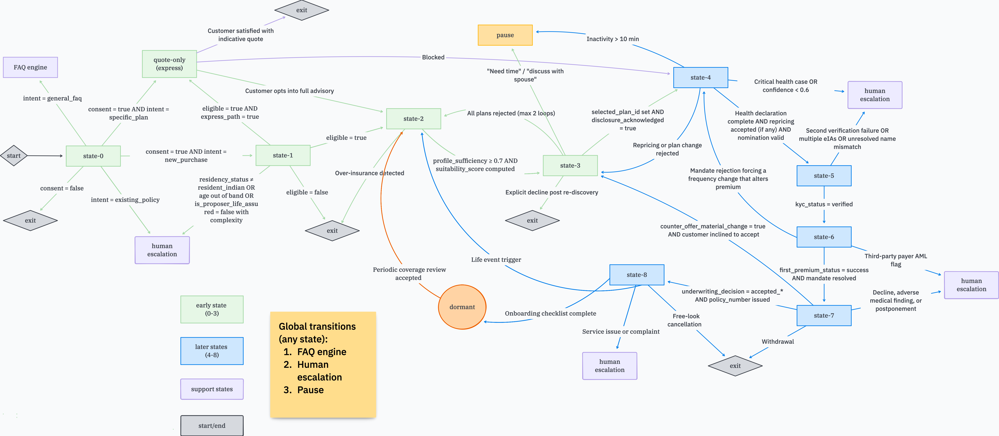

# SurakshaSetu: overview

> **A conversational pre-sale life-insurance advisor for India, where the language model only talks and deterministic, versioned services decide.**

|                    |                                                                                                                                                                                                  |
| ------------------ | ------------------------------------------------------------------------------------------------------------------------------------------------------------------------------------------------ |
| **Phase**          | **Phase 1 complete** (Steps 1–30): States S0–S3, Quote-Only and the support states, ending in a signed hand-off. The production layer (Steps 31–33) is upcoming; see the [roadmap](roadmap.md) |
| **Content status** | Every product, rate, rule threshold, disclosure, consent text, translation and knowledge-base document is **fictitious and marked `DUMMY`** until compliance, actuarial and legal supply approved content |
| **Model status**   | Evaluated against **stub models** only. The real model routes (decision D2) are not provisioned                                                                                                  |

**Conventions.** `monospace` is a real file, command, setting or identifier. Paths are relative to the repository root. `TDD §x` names a section of the project's internal technical design document, which code comments cite. A _pin_ is a version fixed to a session at its start. A _DUMMY_ artefact is placeholder content that a release gate must block from reaching a customer in pilot or production. Every latency and quality figure in this documentation was measured **with stub models, CPU-only embedding and a small fictitious corpus**, so none of it predicts production behaviour.

**Where to go next**

| To learn… | Read |
| --- | --- |
| How the pieces fit, what runs where, and the repository layout | [architecture](architecture.md) |
| The state machine and the eight invariants | [state-machine](state-machine.md) |
| Data, encryption and the audit trail | [data-and-audit](data-and-audit.md) |
| How each subsystem behaves (retrieval, rails, rules, S0–S3, handlers) | [subsystems](subsystems.md) |
| The two API contracts | [api-reference](api-reference.md) |
| How to run, configure and operate it | [operations](operations.md) |
| What was measured | [evaluation](evaluation.md) |
| Why it is built this way | [decisions](decisions.md) |
| What is done, what is next, what blocks a pilot | [roadmap](roadmap.md) |
| Release and sign-off process | [`RELEASING.md`](../RELEASING.md) |
| Gateway hardening, row by row | [`infra/omniroute/HARDENING.md`](../infra/omniroute/HARDENING.md) |
| Terms | [glossary](glossary.md) |

## What SurakshaSetu is

SurakshaSetu ("suraksha" = protection, "setu" = bridge) is a **chat assistant that guides a prospective customer through the pre-sale part of buying life insurance in India**: consent, eligibility screening, needs discovery, a suitability assessment, a ranked and cited recommendation with the mandatory disclosures, and finally a **signed hand-off** of the customer's chosen plan to the insurer's existing application journey.

It speaks English, Hindi and Hinglish. It runs as two tiers that talk over a versioned OpenAPI contract:

- a **conversation tier** in Python (FastAPI, LangGraph) that holds the dialogue, the state machine, the guardrails and the audit trail;
- a **domain tier** in Java (Spring Boot, DMN) that owns consent, the product catalogue, the disclosure registry and every decision that involves a number: eligibility, suitability, cover sizing, ranking and premium quotes.

A small React chat client (`frontend/`) sits in front of the conversation tier.

## The problem it addresses

Putting a large language model in front of a life-insurance customer creates four risks that a regulated insurer cannot accept:

| Risk                                             | What could go wrong                                                                 | How the design answers it                                                                                                                                                                                                                                              |
| ------------------------------------------------ | ----------------------------------------------------------------------------------- | ---------------------------------------------------------------------------------------------------------------------------------------------------------------------------------------------------------------------------------------------------------------------- |
| **Hallucinated facts and numbers**               | The model invents a premium, a benefit or a clause                                  | The model never writes a number. Numbers are placeholders like `{{premium:<UIN>}}` that a composer fills from engine results; a numeric rail rejects anything else                                                                                                     |
| **Mis-selling**                                  | A recommendation that does not fit the customer's need or budget                    | Eligibility and suitability are DMN decision tables with reason codes. Ranking weights, caps and thresholds are versioned data that compliance owns; commission is never an input, and a build-time test enforces that                                                 |
| **Consent and privacy breaches** (DPDP Act 2023) | Personal data stored or processed without a valid purpose, or kept after withdrawal | Only a Consent Service records consent. No slot is stored and no decision service is called before valid consent (invariant I1). Withdrawal is honoured in the same turn from any state (I5). Personal data is encrypted per subject, so erasure is destroying the key |
| **No way to prove what happened**                | A regulator or auditor asks "why was this recommended?"                             | Every turn appends hash-chained audit events _before_ the response is released (I8). A session dossier reproduces the decision from stored inputs and rule versions                                                                                                    |

## The core principle

> **The language model is used for language only.**

It interprets what the customer said and explains results that deterministic services produced. It never decides eligibility, suitability, cover, ranking, premiums, state transitions, consent or which disclosures to show. In States S0–S3 it has no tool-calling access to the domain tier at all. Legally significant text (the consent notice, the AI disclosure, material-fact questions, disclosure sets, the hand-off and crisis scripts) is rendered from approved templates and a hash-verified registry, never generated.

## Primary capabilities

| Capability                         | What it does                                                                                                                                                                       | Where it lives                                             |
| ---------------------------------- | ---------------------------------------------------------------------------------------------------------------------------------------------------------------------------------- | ---------------------------------------------------------- |
| **Consent and AI disclosure (S0)** | Greets, discloses that the customer is talking to an AI, captures purpose-based consent P1/P2/P3 and an 18+ declaration through a form or a strict typed parser                    | `graph/states/s0.py`, domain `consent/`                    |
| **Eligibility screening (S1)**     | Asks only the questions the eligibility rules require, reads back what it understood, evaluates the DMN table                                                                      | `graph/states/s1.py`, domain `eligibility/`                |
| **Quote-Only express path**        | A named plan, a few facts and an indicative quote, with a hard block on applying                                                                                                   | `graph/states/quote_only.py`, domain `quote/`              |
| **Needs and suitability (S2)**     | Collects goals, income, dependants, liabilities and budget; the suitability engine sizes cover with a documented formula and grades affordability                                  | `graph/states/s2.py`, domain `suitability/`                |
| **Recommendation (S3)**            | Up to three ranked, cited options with comparison table, complete hash-verified disclosures, re-quotes and cheaper alternatives                                                    | `graph/states/s3.py`, domain `ranking/`, `disclosure/`     |
| **Signed hand-off**                | An Ed25519-signed intake payload (hashes, not copies, of the disclosures) posted to the application journey                                                                        | `handoff/intake.py`, `tools/stubs/journey.py`              |
| **Cross-cutting handlers**         | Data erasure, human escalation with a redacted briefing, pause and resume, safety, the "am I talking to a person?" answer, FAQ side-queries, objection handling, inactivity timers | `graph/handlers/`, `graph/side_query.py`, `jobs/timers.py` |
| **Guardrails**                     | Four input rails, three output rails and a release policy, all auditable                                                                                                           | `rails/`, `analysis/`                                      |
| **Retrieval-augmented answers**    | Hybrid dense plus BM25 search, rerank, a sufficiency gate that abstains on weak evidence, and `[Source: …]` citations                                                              | `retrieval/`, `kb/`                                        |
| **Immutable audit and dossier**    | Hash-chained, per-subject-encrypted events, a daily object-locked anchor, and a verifiable session dossier                                                                         | `audit/`                                                   |
| **Release gates**                  | Golden and red-team conversations plus a pilot-mode DUMMY gate that must pass (results in [evaluation](evaluation.md))                                                             | `make eval`, `make verify-release-gate`                    |

## Users and use cases

| Audience                            | Interest                                                                                                                                                                               |
| ----------------------------------- | -------------------------------------------------------------------------------------------------------------------------------------------------------------------------------------- |
| **Prospective customers**           | A plain-language chat in English, Hindi or Hinglish that explains what cover they need, shows options with real disclosures, and hands off to the application journey when they choose |
| **Compliance officers and the DPO** | Consent integrity, disclosure completeness, withdrawal and erasure, the audit trail and dossier, DUMMY gates, the output lexicon, the red-team results                                 |
| **Advisors and the care team**      | A human-escalation hand-off with a redacted briefing (no transcript) and a queue (`advisor` or `care`)                                                                                 |
| **Actuarial and tax teams**         | The versioned DMN tables, actuarial parameters, rating table, ranking weights and the GST treatment, all in files with owners                                                          |
| **Product owners**                  | The catalogue, riders, the disclosure registry, prompt bundles and the golden conversations                                                                                            |
| **Engineers and SREs**              | A contract-first two-tier system with a pure state machine, property tests, a hardened gateway and a reproducible local stack                                                          |

## Scope

| In Phase 1 (complete)                                                                                                       | Out of Phase 1                                                                                                                                                                        |
| ------------------------------------------------------------------------------------------------------------------------ | ------------------------------------------------------------------------------------------------------------------------------------------------------------------------------------- |
| S0 greeting and consent, S1 eligibility, Quote-Only, S2 needs and suitability, S3 recommendation                         | S4 application intake and health declaration, S5 identity and KYC, S6 payment, S7 underwriting liaison, S8 post-sale (they replace the hand-off adapter later without touching S0–S3) |
| FAQ side-queries, objection handling, human escalation, pause, exit, exit (advisory), data erasure, the hand-off         | Voice, WhatsApp, savings/par/ULIP products, group and corporate cover                                                                                                                 |
| Launch products: term plans with riders (fictitious `999N001V02`, `999N002V01`; `999N010V01` is seeded but switched off) | Real products, real rates, real disclosures (they arrive through the gated release pipeline)                                                                                          |
| English, Hindi (`hi-IN` placeholders marked `DUMMY: [hi translation pending approval]`) and Hinglish understanding       | Approved Hindi copy                                                                                                                                                                   |
| Local, single-machine deployment on Docker Compose                                                                       | Production infrastructure (upcoming: Steps 31–33 and pilot work; see the [roadmap](roadmap.md))                                                                                                                                |

## The customer journey at a glance

The product specification defines nine states (S0–S8). Phase 1 implements S0–S3, a Quote-Only side path and the support states. The diagram is the state machine the code encodes (generated from `fsm/rows.py`); [state-machine](state-machine.md) lists every row.

The product specification's full nine-state flow, with the part Phase 1 builds (S0–S3) in green:

## What is real and what is placeholder

This matters for anyone judging the maturity of the project.

| Real and working                                                                                             | Placeholder or not yet real                                                                                                                       |
| ------------------------------------------------------------------------------------------------------------ | ------------------------------------------------------------------------------------------------------------------------------------------------- |
| The architecture, both tiers, the contract, the state machine, the invariants and their tests                | Every product, rate, loading, GST rate, ranking weight, affordability band and rider rule (DUMMY until decision D6)                               |
| Per-subject encryption, the hash chain, daily anchors, erasure, the dossier                                  | The model routes: all six chat routes point at deterministic stubs, so faithfulness, slot F1 and critical-intent recall cannot be judged yet (D2) |
| The hardened gateway configuration and its 16 tested rows                                                    | Consent notices, disclosures, scripts, Hindi translations and the KB corpus (all marked `DUMMY`)                                                  |
| The retrieval pipeline, snapshots and the gates, which _fail_ honestly on the regulatory and tax collections | Production infrastructure: India-region KMS/HSM, a real RFC 3161 time-stamp authority, mTLS, SSO, the WORM stream                                 |
| A browser UI that renders only what the server sent                                                          | Advisor tooling, the canary pipeline, Kafka/Debezium, Langfuse, ClickHouse                                                                        |
