# State machine and invariants

The pure transition function that decides every move between states, the rows it evaluates, and the eight invariants that hold on every conversation. The turn runtime that calls it is described in [architecture](architecture.md#the-langgraph-turn-graph).

## The conversation state machine

The transition function is **pure**: `fsm.transition(facts, state, thresholds) -> Transition{to, row_id, reason_code, subgraph, invariants}`. The `fsm/` package has no I/O, no logging and no clock; a static test scans its imports. The model never sets `consent`, `eligibility`, `suitability`, `selected` or `acks_valid_for_selected`; analysis contributes intents and signals only.

**Evaluation order.** Cross-cutting and guard rows whose scope includes the current state are tried first, by order; then the state's own rows by order; each state ends with an unconditional `STAY`. The first match wins. A Hypothesis test fails the build if any input matches zero rows or two rows share an order.

_The diagram is the output of `python -m surakshasetu.fsm.mermaid`, lightly adapted for labels. It omits the `STAY` rows and the cross-cutting rows, which follow._

**Cross-cutting and guard rows** (apply in every state in their scope, before the state's own rows):

| Row  | Order | Scope             | Effect                            | Condition                                                                            | Reason code                                                                  |
| ---- | ----- | ----------------- | --------------------------------- | ------------------------------------------------------------------------------------ | ---------------------------------------------------------------------------- |
| CC1  | 1     | all active states | → Data Erasure                    | `withdraw` (I5)                                                                      | `WITHDRAW`                                                                   |
| CC1b | 2     | all active states | → Data Erasure                    | `minor` (stated age under 18, 18+ box unticked, or the engine's `DATA_ERASURE_EXIT`) | `MINOR`                                                                      |
| CC2  | 3     | all active states | → Human Escalation                | mandatory trigger, human request, frustration, or low-confidence streak ≥ limit      | the trigger's code, else `HE_REQUEST`, `HE_FRUSTRATION`, `HE_LOW_CONFIDENCE` |
| CC3  | 4     | S0–S3, QO         | → Pause                           | consent given ever, and inactivity timeout or `dependency_down`                      | `INACTIVITY` / `DEPENDENCY_DOWN`                                             |
| G1   | 5     | S1, QO, S2, S3    | → S0                              | no valid P1 consent                                                                  | `CONSENT_LAPSED`                                                             |
| G2   | 6     | S2, S3            | → S1                              | an eligibility fact changed                                                          | `CORRECTION_ELIGIBILITY`                                                     |
| G3   | 7     | S3                | → S2                              | a needs fact changed                                                                 | `CORRECTION_NEEDS`                                                           |
| G4   | 8     | S3                | → S2                              | suitability record no longer current                                                 | `SUITABILITY_STALE`                                                          |
| CC4  | 9     | S0–S3, QO         | stay, run the side-query subgraph | FAQ                                                                                  | `FAQ`                                                                        |
| CC5  | 10    | S0–S3, QO         | stay, run the objection subgraph  | objection                                                                            | `OBJECTION`                                                                  |
| CC3b | 11    | S1, QO, S2        | → Pause                           | consent given ever, and the customer needs time                                      | `NEED_TIME`                                                                  |
| CC5b | 12    | S1, QO, S2, S3    | → Exit                            | customer ends the conversation                                                       | `OBJECTION_EXIT`                                                             |

The guards G1–G4 precede CC4/CC5 so that a FAQ or an objection can never keep a lapsed or stale session in place.

**State rows:**

| Row     | Order | →                | Condition                                                                      | Reason code                                |
| ------- | ----- | ---------------- | ------------------------------------------------------------------------------ | ------------------------------------------ |
| S0.1    | 1     | Human Escalation | existing-policy intent                                                         | `HE_EXISTING_POLICY`                       |
| S0.2    | 2     | Exit             | consent refused                                                                | `CONSENT_REFUSED`                          |
| S0.3    | 3     | Quote-Only       | valid P1 and specific plan                                                     | `SPECIFIC_PLAN`                            |
| S0.4    | 4     | S1               | valid P1 and new purchase                                                      | `NEW_PURCHASE`                             |
| S1.0    | 0     | Data Erasure     | eligibility outcome `DATA_ERASURE_EXIT`                                        | `MINOR`                                    |
| S1.1    | 1     | Human Escalation | outcome `HUMAN_ESCALATION`                                                     | the engine's reason, else `HE_ELIGIBILITY` |
| S1.1b   | 2     | Human Escalation | `RE_ASK` and re-ask exhausted                                                  | `HE_RE_ASK_LIMIT`                          |
| S1.2    | 3     | Exit             | `NOT_ELIGIBLE`                                                                 | `NOT_ELIGIBLE`                             |
| S1.3    | 4     | Quote-Only       | eligible and express path                                                      | `EXPRESS_PATH`                             |
| S1.4    | 5     | S2               | eligible                                                                       | `ELIGIBLE`                                 |
| QO.1    | 1     | _stay_           | apply request (hard block C13)                                                 | `HARD_BLOCK_C13`                           |
| QO.2    | 2     | Exit             | satisfied with quote                                                           | `QUOTE_SATISFIED`                          |
| QO.3    | 3     | S2               | advisory opt-in and eligible                                                   | `ADVISORY_OPT_IN`                          |
| QO.3b   | 4     | S1               | advisory opt-in and not yet eligible                                           | `ADVISORY_OPT_IN_SCREEN`                   |
| S2.1b   | 1     | Human Escalation | current suitability outcome `ESCALATE`                                         | the engine's reason, else `HE_SUITABILITY` |
| S2.1    | 2     | Exit (Advisory)  | over-insured (current `NO_GAP`)                                                | `NO_GAP`                                   |
| S2.2    | 3     | S3               | current `FIT`, and (sufficiency ≥ minimum or elected), and (amber ⇒ confirmed) | `SUITABLE`                                 |
| S3.0    | 0     | Human Escalation | no options                                                                     | `HE_NO_OPTION`                             |
| S3.1    | 1     | Exit             | explicit decline after a re-discovery loop                                     | `DECLINED`                                 |
| S3.2    | 2     | Pause            | needs time                                                                     | `NEED_TIME`                                |
| S3.3    | 3     | S2               | all rejected and loops < limit                                                 | `REDISCOVERY`                              |
| S3.3b   | 4     | Human Escalation | all rejected and loops ≥ limit                                                 | `HE_REDISCOVERY_LIMIT`                     |
| S3.4    | 5     | Hand-off         | plan selected, quote valid, acknowledgments valid for it, eligible UIN (V7)    | `HANDOFF`                                  |
| PAUSE.R | 1     | _resumes_        | any customer turn (a timer tick stays)                                         | `RESUMED`                                  |

`PAUSE` runs only CC1, CC1b, CC2 and `PAUSE.R`: a customer turn resumes into the state it paused from (S0 if unknown) and is evaluated there, guards included. The five terminal states (Human Escalation, Exit, Exit (Advisory), Data Erasure, Hand-off) have one `STAY` row and no cross-cutting rows; a withdrawal on a closed session reports `I5: false`, and the runtime routes it to erasure outside the FSM.

`Transition.invariants` reports only what the FSM can check itself: **I1** (entering S1, QO, S2, S3 or Hand-off requires valid P1), **I2** (entering S3 requires a current suitability record) and **I5** (withdrawal leads to Data Erasure). I3, I4, I6, I7 and I8 are never claimed by the FSM; the golden harness asserts them on every conversation.

## The eight invariants

These are the load-bearing rules (TDD §3.2). A change to any of them needs the project owner's explicit sign-off before code moves.

| ID     | Rule                                                                                                                        | Enforced by                                                                                                                                                                                                                       | Proved by                                                                                                 |
| ------ | --------------------------------------------------------------------------------------------------------------------------- | --------------------------------------------------------------------------------------------------------------------------------------------------------------------------------------------------------------------------------- | --------------------------------------------------------------------------------------------------------- |
| **I1** | No slot is persisted and no decision service is called before a valid P1 consent record exists                              | DB: `conv.slot_value.consent_id` is `NOT NULL` and references `consent.record`. FSM guard G1 and `Transition.invariants`. Slot rows need `session.consent`. S0 makes reference reads only                                         | Hypothesis properties; golden check on every conversation; gate `consent_integrity` = 0 over 207 sessions |
| **I2** | S3 is unreachable without a confirmed suitability record whose inputs hash matches the confirmed slot hash                  | Rows S2.2 and G4; the needs hash is computed identically in both tiers (shared `content/testvectors/needs/`); "evaluate, then bind" in S2                                                                                         | Properties; the harness re-hashes the audited suitability request at each S3 entry                        |
| **I3** | No product name or UIN is output before S3, unless the customer named it                                                    | Retrieval gate (`kb_product` only in S3 or with a focus UIN); output rail GR-PRODUCT; Quote-Only names only the customer's plan, never a list                                                                                     | Golden check; red-team category `uin_leak` (9 attacks, 0 successes)                                       |
| **I4** | Every S3 product presentation includes its complete, hash-verified disclosure set                                           | The composer inserts registry bodies verbatim; rail RC-DISCLOSURE recomputes body and set hashes; acknowledgments bind to the hashes shown                                                                                        | Gate `disclosure_completeness` = 1.000 over 65 S3 renders                                                 |
| **I5** | A consent withdrawal is honoured in the same turn, from any state                                                           | First check in the turn router; row CC1; the erasure handler plus a retrying sweep                                                                                                                                                | Gate `withdrawal_honoured` = 1.000 over 13 withdrawals                                                    |
| **I6** | "Am I talking to a person?" always gets a truthful, templated answer                                                        | `graph/handlers/identity.py` matches a closed lexicon (165 phrases in en, hi, hi-Latn in bundle `pb-2026.10.8`); `ai_redisclosure` is released first; output lexicon rule LX-HUM-19                                               | Golden check on turns tagged `identity`; red-team                                                         |
| **I7** | Version pins (prompt bundle, rules, corpus snapshot, consent notice) never change mid-session, except through kill switches | Pins recorded at session creation; `load_pinned` refuses a missing or hash-failing bundle. Two signed-off exceptions: kill switches, and the consent-notice pin moving to the notice a consent record is captured on (2026-10-04) | Golden check on the audit pins of every event                                                             |
| **I8** | No response is released before its audit record commits                                                                     | One transaction from `load` to `commit`; the `release` node runs after the commit                                                                                                                                                 | Gate `audit_integrity` (released-after-commit) = 1.000 over 2,502 responses                               |
