# Subsystems

How each major part behaves, in the order a turn meets them: retrieval, composition and the rails, the domain tier, then each journey state and the cross-cutting handlers. For how the parts connect see [architecture](architecture.md); for the state transitions see [state-machine](state-machine.md).

## Knowledge base and retrieval

**Three collections** in Qdrant (`kb_regulatory`, `kb_product`, `kb_tax`), each with a dense vector (`dense`, 1,024 dimensions, cosine) and a sparse `bm25` vector. **Product numbers and mandatory text never come from here**; retrieval supplies explanation and citations only.

**Ingestion** (`surakshasetu_ingest`, `make kb-ingest`, `make kb-verify`) is a review-gated Dagster pipeline: `source_docs → parsed (Docling, Markdown only) → chunks → enriched → approved → vectors → indexed_snapshot`.

- Every source file carries YAML front matter; the first line of every section starts `DUMMY:` (a unit test checks the whole corpus); `review-manifest.yaml` records per-document approval, and only approved documents are indexed (`irdai-ed-ai-2026` is pending on purpose).
- `chunk_id = <domain>:<doc_id>:<section_id>:<content_sha256[:6]>`; the Qdrant point id is a UUIDv5 over `<snapshot_id>/<chunk_id>`, so a newer snapshot never overwrites an older pin.
- **Snapshots are immutable.** Changing any approved document needs a new `snapshot_id`; the old row becomes `superseded` and its points stay searchable for sessions that pinned it. Seed state: `regulatory-2026-09-29` (45 chunks, 7 documents), `product-2026-09-29` (45, 12) and `tax-2026-09-29` (48, 9).
- The BM25 analyser keeps legal tokens whole (`80C`, `10(10D)`, `194DA`, UINs, tax years) and any analyser change needs a new `ANALYZER_VERSION` and new snapshots.

**Retrieval** (`retrieval/service.py`) is `select` (all the I/O) followed by `decide` (the pure gate):

- Pins are verified once per process (the snapshot row exists, the collection and analyser match, the point count equals `chunk_count`); per turn the served embed and rerank models must match the snapshot's stamp or retrieval refuses (`EMBED_MODEL_MISMATCH`, `RERANKER_MISMATCH`).
- **Thresholds** live in `content/kb/thresholds.yaml`, written only by `make calibrate-retrieval`, keyed by snapshot id and stamped with the reranker. Calibrated values (gte, lexical query): rerank 0.533916 (regulatory), 0.54517 (product), 0.505791 (tax); BM25 6.183241 / 4.465888 / 4.610288; degraded factor 1.25.
- **Fallbacks.** Embed down: BM25-only search, still reranked. Rerank down: BM25-only search scored by BM25. Either gates at the threshold times 1.25.
- **Conflicts.** Evidence stays in rerank order with a `precedence` rank (TDD §2.5) on each chunk; the claim check cites the higher source and logs the corpus defect.
- **Module boundary.** `retrieval` never imports `domain`, and nothing under `domain/` or named `*disclosure*|*premium*|*placeholder*|*quote*` imports `retrieval` (`test_retrieval_boundary.py`).

### Models

| Role                      | Model                                       | Why                                                                                                                                                                                  |
| ------------------------- | ------------------------------------------- | ------------------------------------------------------------------------------------------------------------------------------------------------------------------------------------ |
| Embedder                  | BAAI/bge-m3, 1,024 dimensions, multilingual | Tied with Qwen3-Embedding-0.6B on first-stage recall within 20-question noise and indexes 3.7× faster on CPU; multilingual-e5-large-instruct was dropped for its 512-token window    |
| Reranker (running choice) | Alibaba-NLP/gte-multilingual-reranker-base  | Best Hinglish abstention (answers 12 of 12 Hinglish questions) and 2.4× faster than bge-reranker-v2-m3 on CPU. **The final reranker choice is still an open decision** (see [evaluation](evaluation.md#retrieval-evaluation)) |
| Chat routes               | None provisioned                            | Six routes point at deterministic stubs until decision D2 (frontier-model hosting)                                                                                                   |

## Composition, guardrails and the release policy

**Prompt architecture (TDD §3.4).** A _prompt bundle_ (`content/prompt-bundles/pb-2026.10.8/`) is hash-locked content:

| Part                                                          | Content                                                                                                                                                                                                                                          |
| ------------------------------------------------------------- | ------------------------------------------------------------------------------------------------------------------------------------------------------------------------------------------------------------------------------------------------ |
| `manifest.yaml`                                               | `version`, `is_dummy`, `insurer`, two distinct `approved_by`, token `budgets` (constitution 1,500; state 500; facts 600; summary 400; recent turns 1,500; evidence 3,000; user turn 500), `summary_every_turns: 6`, and a SHA-256 for every file |
| `l0/constitution.txt`                                         | The global rules, TDD §3.4 byte for byte (a test pins it)                                                                                                                                                                                        |
| `l1/{S1,S2,S3,side-query,summarise}.txt`                      | One instruction set per generation route                                                                                                                                                                                                         |
| `templates/{en-IN,hi-IN}/{slots,scripts,recommendation}.yaml` | Pydantic-validated (`extra=forbid`): 21 slot questions keyed by the DMN reason-line ids, 116 script keys, the S3 layout                                                                                                                          |
| `lexicons/*.yaml`                                             | Closed phrase lists used by deterministic code (consent affirmation, identity question, screening, needs, S3, side-query)                                                                                                                        |

`load_bundle` refuses an unknown or malformed version, an invalid manifest, a missing, unlisted or changed file, invalid templates, an over-budget L0/L1, and a `DUMMY` bundle in pilot or prod. Once a database has recorded a bundle's `CONFIG_RELEASE`, any change is a new version; nine versions exist (`pb-2026.09.1`, `pb-2026.10.1` … `pb-2026.10.8`) and every older one has been retired by a kill switch.

**The envelope** (`compose/envelope.py`) is exactly two messages: _system_ = L0 + L1, and _user_ = `<session_facts>`, `
`, `<recent_turns>`, `ENGINE_RESULT:` blocks (`<engine id="R1">`), `EVIDENCE:` blocks (`<evidence id="E1" label precedence parent>`) and the turn's `<user_input>`. Every tagged text is HTML-escaped. `SessionFacts` carries language, answered-slot names and relation/liability kinds, **never numbers or identifiers**. Each message is scanned with the redaction rail; any hit means `PII_IN_ENVELOPE` and no envelope, so the turn takes the template path. Only a clean envelope carries the `RedactionAttestation` the gateway demands.

**Placeholders and citations.**

- The model may write a number only as `{{premium|cover|term|ppt|gap:<UIN of a ranked option>}}` or `{{need}}`; `compose/placeholders.py` fills them from the ranking and suitability results, with Indian digit grouping (`₹1,00,00,000`). A leftover brace is `MALFORMED`.
- Evidence is `[E#]`, engine results `[R#]`. `compose/citations.py` issues handles per turn, refuses an engine fact whose key looks like money, and renders `[E3]` as `[Source: <label>]`; an unissued handle raises `CitationError`.

**The composer** (`compose/composer.py`) builds an S3 reply from parts in a fixed order: `needs_recap`, `option_card:<UIN>` for each option, `comparison` (two or more options), `why_it_fits` (the narrative, filled and cited; with no narrative, the deterministic card plus an advisor offer), `disclosures:<UIN>` for each option (registry bodies verbatim), `cta`, `sources`.

**Rails.** TDD §4.2 defines the guardrail layers; the build implements them as follows. Each rail audits one `GUARD_VERDICT` event per turn (or per attempt for output rails), whether it passes or hits, with rule ids and scores and never customer text.

| Layer               | Rail                                 | What it does                                                                                                                                                                                                                                                                                                                                                           |
| ------------------- | ------------------------------------ | ---------------------------------------------------------------------------------------------------------------------------------------------------------------------------------------------------------------------------------------------------------------------------------------------------------------------------------------------------------------------- |
| Input               | **Normalise** (`rails/normalise.py`) | NFKC; strips zero-width characters; folds Cyrillic and Greek look-alikes to Latin (Devanagari is never folded); 500-token cap (`overlong`); language ID en / hi / hi-Latn                                                                                                                                                                                              |
| Input               | **Redact** (`rails/redact.py`)       | Presidio with six custom Indian recognizers (Aadhaar with Verhoeff checksum, card with Luhn, PAN, mobile, IFSC, bank account) plus email. Two outputs: `stored_raw` (Aadhaar, card and bank numbers masked) for encryption and `nlu-extract`, and `redacted` (every entity tokenised `<TYPE_n>`) for logs and `REDACTED` routes. A never-store hit triggers a reminder |
| Input               | **Injection** (`rails/injection.py`) | About 12 heuristic patterns in English, Hindi and Hinglish combined with `guard-input`'s `injection_score` (threshold 0.5). A block keeps only a withdrawal intent and drops every slot (I5)                                                                                                                                                                           |
| Input               | **Safety** (`rails/safety.py`)       | Self-harm (S11) **fails closed**: if the guard is unavailable, a local lexicon hit still routes to the Safety handler                                                                                                                                                                                                                                                  |
| Output (model text) | **Lexicon pack** (`rails/output.py`) | 20 compliance-owned rules (LX-GUAR-01 … LX-CMP-20; the first six are TDD §4.2 verbatim), in English, Hindi and Hinglish: guarantees, superlatives, urgency, replacement advice, tax claims, "I am a human", competitor comparison                                                                                                                                      |
| Output (model text) | **Grounding**                        | GR-PRODUCT (I3), GR-PLACEHOLDER, GR-NUMBER (every numeral must appear in a source its own sentence cites), GR-HANDLE, GR-CITATION, GR-NLI (`verify-claims` per cited sentence; always on `gen-recommend`, sampled at 10 % on `gen-converse`)                                                                                                                           |
| Output (whole turn) | **Release checks**                   | RC-DISCLOSURE (I4: recomputes body and set hashes), RC-GUARD (output-mode guard call; unavailable means blocked), RC-LEAK (no `<TYPE_n>` token, no foreign UUID, no unapproved PII, no 8-word window of L0/L1), RC-DUMMY (counts `DUMMY` in dev and **blocks in pilot and prod**)                                                                                      |

**Release policy** (`release(...)`): if the model-text rails fail, regenerate **once** with the error list (rule ids, handles and the model's own words, never customer text) in a `VALIDATOR_ERRORS:` block; if it fails again, or the route is down, fall back to the deterministic card (S3) or the template (S1–S2). If the NLI judge is unavailable, hold the draft and render the template (fail closed). If any whole-turn release check blocks, the customer receives `release_blocked` plus `advisor_offer`. Legally significant text never depends on a rail passing, because it is not generated.

## The domain tier

`domain-services/` (`com.surakshasetu.domain.{consent,catalog,disclosure,eligibility,suitability,ranking,quote,reference,common}`) implements all 23 contract operations.

**Rule engine.** Apache KIE DMN 10.2.0 is embedded through `DMNRuntimeBuilder`: no Kogito code generation, no KIE starter. A _rules version_ is `dmn/eligibility-<v>.dmn` + `dmn/suitability-<v>.dmn` + one `params/actuarial-*.yaml` naming it; startup fails if any part is missing, misnamed or does not compile. **Every shipped version stays loaded** (I7); `/v1/meta/versions` serves the newest, and a request evaluates exactly its `pins.rules`. To change a rule or parameter, add files under a new version; never edit a shipped one. Thresholds live only in the DMN tables and params YAML; Java holds none.

| Model       | Decision table        | Hit policy | Rules |
| ----------- | --------------------- | ---------- | ----- |
| eligibility | `Eligibility`         | FIRST      | 6     |
| eligibility | `RequiredAttributes`  | RULE ORDER | 11    |
| suitability | `RequiredSlots`       | RULE ORDER | 10    |
| suitability | `FitTypes`            | RULE ORDER | 11    |
| suitability | `ComplexGoals`        | FIRST      | 2     |
| suitability | `Exclusions`          | COLLECT    | 4     |
| suitability | `IncomeMultiple`      | UNIQUE     | 6     |
| suitability | `Vulnerability`       | COLLECT    | 5     |
| suitability | `AffordabilityLimits` | UNIQUE     | 2     |
| suitability | `Affordability`       | FIRST      | 4     |
| suitability | `Plausibility`        | COLLECT    | 2     |
| suitability | `Outcome`             | RULE ORDER | 6     |

- **Eligibility** (`EligibilityController`): the DMN table runs on the proposer's age first (rows E-03, E-05, E-04, E-06, E-02, E-01); Java then adds proposer complexity, pincode serviceability, the flags `MANUAL_UW`, `MEDICAL_UW`, `PREMIUM_WITHHELD`, the underwriting path and `eligible_uins` (in force, launched, entry age, minimum term before maturity, as of now in IST). Precedence: `DATA_ERASURE_EXIT` > `HUMAN_ESCALATION` > `NOT_ELIGIBLE` > `RE_ASK` > `ELIGIBLE`. Where the proposer is not the life assured, the result for the life assured's age applies, and a missing or unusual relationship escalates (`HE_COMPLEX_PROPOSER`).
- **Suitability** (`SuitabilityController`, `SuitabilityCalculator`): the calculator is only the TDD §3.7 cover formula; every threshold is in the tables. Cover term `n = min(longest dependency, cover_to_age − age)` (a child depends until the independence age; any other relation until `cover_to_age`). Cover bands round up to the sum-assured step but never above the tightest cap. Outcome order: `HE_VULNERABLE_COMPLEX` > `HE_OUT_OF_SCOPE` > `HE_AFFORDABILITY_RED` > `NO_GAP` > `FIT`. Every match lands in `reason_codes`; implausible input is a reason code, not an error.
- **Ranking** (`Ranker`, weights file `ranking/weights-2026.09.1.yaml`, owner compliance): candidates are eligible products in a fitting category, in force and launched, minus kill-switched products, with a feasible term. Nothing is ranked unless the outcome is `FIT` with cover > 0 (otherwise `[]` plus `NO_ELIGIBLE_OPTION`). **DUMMY score = 0.60 × need coverage + 0.30 × affordability + 0.10 × rider fit**; ties go to the lower premium, then the UIN; the top 3 are returned. Commission, margin and incentives are never inputs, and `CommercialFieldBanTest` (ArchUnit) fails the build if such a field appears in any decision type, generated contract model, weights key or resource file.
- **Quotes** (`QuoteAdapter`, `StubRatingEngine`): premium = SA/1,000 × base rate (age band × term band) × tobacco loading × PPT loading × gender loading (if rated); riders add their own rate; GST is applied per component (DUMMY rate `0.00`, tax must confirm). `validate` runs in a fixed order and each failure is `422 QUOTE_OUT_OF_BOUNDS` with the field and its bounds. A quote id is `Q-<IST date>-<seq4>`, valid 30 days. `createQuoteAlternatives` returns `LOWER_COVER` (−25 %, −50 %), `FEWER_RIDERS` and `OTHER_PPT` variants with the protection gap. Premiums come only from this adapter.
- **Consent Service** (`ConsentController`): the only writer of consent. Create checks the Idempotency-Key first; P1 must be present and granted (`422 P1_REQUIRED`); the notice must be the one in force for the language with a matching hash (`422 NOTICE_MISMATCH`). Validity reasons are `P1_NOT_GRANTED`, `WITHDRAWN`, `AGE_NOT_DECLARED`, `NOTICE_SUPERSEDED`, `CONSENT_EXPIRED` (30-day TTL). A withdrawal is final at any instant; purposes are append-only.
- **Disclosure Registry** (`DisclosureController`): a set's candidates are tried newest `registry_version` first and the first whose every member is in force wins. **Every read recomputes each `body_sha256` and the `set_sha256`; a mismatch is `500 REGISTRY_INTEGRITY` and the set is never served.** Effective dates are compared on the IST calendar date.
- **Product kill switch**: sets `status='withdrawn'` and caps `effective_to` at today; idempotent; needs the internal token; never reachable from a fuzzer (the contract test deletes that path from its spec copy).
- **Seed loader** (`SeedLoader`, `make seed-catalog`): loads `content/seed` strictly (unknown keys fail), computes hashes, and refuses changes to immutable rows (a disclosure body, a set under its key, a notice, a document file) so a re-seed cannot undo a kill switch.

Logs carry one INFO line per decision (ids, versions, outcome, rule ids, milliseconds) and never an input value; sentinel tests prove it for every endpoint.

## Input rails and turn analysis

`analysis/pipeline.py::analyse_turn` runs normalise → redact, then `asyncio.gather`s the injection and safety rails (one `guard-input` call feeds both) against `nlu-extract`, which always runs regardless of a rail's outcome. It appends one `TURN_INPUT` and four `GUARD_VERDICT` events per turn. A block keeps only a withdrawal intent and discards every slot, side-query and other intent.

- **`TurnAnalysis`** (`analysis/models.py`, TDD §3.3): slot candidates with confidence and an evidence span, plus the 26-value `Intent` enum. There is **no consent intent and no consent slot**, which a structural test enforces.
- **"Nothing inferred"**: a slot candidate whose `evidence_span` is not a literal substring of the text sent is dropped silently.
- **Deterministic normalisers** (`analysis/normalisers.py`, TDD §3.6): ages ("34 yrs", "born in '91" with century disambiguation, Devanagari digits), money (lakh, crore, Indian grouping, "k a month" annualised with `needs_confirmation`, a bare "k" is `period_ambiguous`), 6-digit pincodes, yes/no/declined in English, Hindi and Hinglish.
- **Confidence policy** (config, never prompt text): at or above 0.8 a value is accepted; 0.6 to 0.8 it is read back; below 0.6 it is dropped, and two such turns in a row escalate (`HE_LOW_CONFIDENCE`).
- If `nlu-extract` fails, the pipeline returns `None` and the state node asks a template question.

## State 0: greeting, AI disclosure, consent

Generates nothing: it releases bundle templates, the registry's `DISC-GLOBAL-AI-06` and the Consent Service's notice, verbatim.

- The greeting is the first turn: the client sends `{action: {type: START}}` when the chat opens (any first message also gets it).
- **Structured path**: `CONSENT_SUBMIT {purposes: {P1, P2, P3}, age_18_plus, notice_version, notice_sha256}` from the form, strict; malformed input re-presents the options. `NOTICE_LANGUAGE {language}` switches the locale while the form is open. `INTENT {intent}` answers the four quick replies.
- **Typed path**: only while the prompt is open, a whole-message match against the bundle's `lexicons/consent_affirmation.yaml` (NFKC, case-folded, final punctuation dropped). An affirmation asks a separate typed 18+ question and then grants **P1 only** (`parsed_affirmation`); anything else re-presents the options.
- **Recording**: only the Consent Service records consent, with the turn key as idempotency key. `NOTICE_MISMATCH` re-renders the notice in force; an outage gives `consent_retry` and never proceeds.
- **Not recorded at all**: P1 unticked means `consent = refused`, so row S0.2 exits politely. P1 ticked with the 18+ box unticked, a typed "minor", or a stated age under 18 means `minor`, so CC1b sends the session to Data Erasure with the key destroyed immediately.
- **Intent**: after consent, the four quick replies or the analysis's intent. Two clarifications are asked; a third unclear answer defaults to `new_purchase`, logged as an INFO `CONFIG_NOTE` (an open point for the specification owner).
- **Volunteered details** are dropped in S0 (only their names are remembered); S1 asks everything after consent.
- **Escalation from S0** always gives contact options with nothing shared, even with P2 consent.

## State 1: eligibility screening

`GET /v1/eligibility/required-attributes` under the session's pinned rules returns the questions in the DMN's order (gender appears only if some product in force is rated by gender; none of the DUMMY products is). Each question is the bundle's `slots[reason_line_id]` template (question plus the reason it is asked). A plain question may lead with one `gen-converse` sentence, which goes through the output rails; any failure sends the template alone.

- **Filling.** `nlu-extract` candidates first; then, only for the open question and only when `nlu-extract` proposed nothing for it, a deterministic parse of the whole message (ages, a single number, pincode checked against the master, yes/no/declined, closed choices, an occupation search). Slot statuses are `proposed`, `corrected`, `declined` (value `null`) and `confirmed` (after the read-back). The same value said again writes no row.
- **Read-back.** The assistant repeats what it understood (a pincode's district, an occupation's label) and a "yes" confirms every asked slot. A born-in age always reads back.
- **Decision.** The confirmed rows go to `evaluate_eligibility`; the request and result are recorded as `ENGINE_DECISION`. `RE_ASK` asks the occupation once more.
- **Edge cases** (`lexicons/screening.yaml`): a health term in a question gets the `underwriting_note` template, in a statement a `medical_ack` plus an advisor quick reply; concealment gets `nondisclosure_note`; an express-path request gets `express_offer`; an unusable answer gets `format_hint`, and after `SS_INVALID_INPUT_LIMIT` (3) an `advisor_offer`; a domain outage gets `screening_retry` and a retry button.
- **Corrections (V4).** From S2 or S3, an eligibility value that changes writes a corrected row, drops the eligibility result, and guard G2 sends the session back to S1 for a new read-back.

## Quote-Only: the express path

For a customer who names a plan (matched on the normalised turn by UIN or catalogue name, longest first; never offered as a list, which keeps I3 intact). It asks only age, tobacco and any stated cover or term, reads back, and calls `create_quote` at the product's `quote_defaults` (or the stated values). The reply is a `quote_card` filled from the quote with Indian grouping, the registry's `DISC-GLOBAL-QUOTE-02`, `quote_caveat` and `quote_next` with OPT_IN and SATISFIED quick replies. Declined tobacco gives `quote_withheld` and no call. A 422 gives `cover_bounds` / `term_bounds` / `age_bounds` with the problem's bounds; 409 `plan_unavailable`; 404 `plan_unknown`; 503 `rating_unavailable` with a retry. An apply request is **hard-blocked** (row QO.1, rule C13): this path has no way to reach the hand-off.

## State 2: needs and suitability

Questions come from `GET /v1/suitability/required-slots` in DMN order: goals, annual income, income type, dependants, liabilities, own cover, employer cover, existing premiums, money set aside, budget (risk profile and horizon are off). Each has a template; the answers are validated by the contract's own types.

- **Money handling.** Every non-zero amount is read back ("₹X a year"); a bare "k" on a yearly slot asks the period first (`PERIOD` action, no row until answered); lakh, crore and grouped digits are read as stated; month words annualise ×12. Declines map to `null` (income, assets, budget), "left out" (dependants, liabilities, own and employer cover), `"0"` (existing premiums) or `[]` (goals, which the engine then escalates).
- **Short path.** A request for a quick route (or the EXPRESS_PATH intent) offers a short path once; accepted, it asks income, dependants and loans, and applies the engine's documented defaults (goal `[income_protection]`, income type `salaried`, premiums `"0"`), listing every assumption in the summary. Profile sufficiency is then 0.85.
- **Evaluate, then bind** (project decision, 2026-10-04). When every asked slot has a value, the node computes the needs hash, sets the request's `needs.slots_sha256` to it, calls the Suitability Service, records the request exactly as sent, and presents the summary (with every assumption the result lists). A result whose `inputs_sha256` differs is an `I2` error and nothing is bound. The customer's "yes" binds the hash to the record; only then do S2's rows apply: `ESCALATE` → Human Escalation, `NO_GAP` → Exit (Advisory), `FIT` below the sufficiency minimum → a `partial_offer` the customer may elect (`SUFFICIENCY_ELECTION` event), an amber affordability band → `amber_confirm`, else S3.
- **Edge cases** (`lexicons/needs.yaml`): distress gets `distress_ack` with an advisor or continue choice and a `financial_distress` row; comprehension difficulty gets a rephrase and a count; income 0 or homemaker, student, retired gets `non_earning_basis` (the engine escalates `HE_OUT_OF_SCOPE`, because the non-earning cover basis is undefined until D6).
- **Dependency down.** A Suitability Service 5xx or timeout, or an unbindable result, sets `dependency_down`; CC3 pauses the session, the slot rows commit with the turn, and the resume re-evaluates.

## State 3: recommendation and hand-off

`s3.present` runs on entry and on every re-render:

1. `POST /v1/ranking/rank` with the eligible UINs and flags, the bound suitability record, the life assured's age, tobacco, channel, locale and `as_of`. `excluded_uins` holds **only kill-switched products** (a project decision: excluding rejected plans would make the "at most two loops, then a person" rule unreachable with two launch products). A ranking whose `suitability_inputs_sha256` is not the needs hash is an `I2` error.
2. Per option: `get_product`, `get_disclosure_set` (channel, locale), retrieval evidence (focus = the option UINs), engine facts `[R#]` with no money, then `gen-recommend` with the S3 instructions.
3. The composer assembles the reply (see [Composition, guardrails and the release policy](#composition-guardrails-and-the-release-policy)); `validate` runs the rails with the issued handles, the numbers and the disclosure sets; `commit` records `conv.recommendation` (the I2 hash, the released text's hash, cited handles) and, per UIN, what was shown (registry version, set hash, document hashes).

A turn in S3 checks, in order: corrections (V4 hooks), the guards, the rows (SAVE or need-time → Pause; REJECT_ALL → re-discovery; DECLINE), revalidation (a kill switch or withdrawal ranks again with `rerank_note`; an expired quote re-quotes with `requote_note`), then the action or free text.

| Action                                                                           | Effect                                                                                                                                                                                                                                                                                                                                 |
| -------------------------------------------------------------------------------- | -------------------------------------------------------------------------------------------------------------------------------------------------------------------------------------------------------------------------------------------------------------------------------------------------------------------------------------- |
| `APPLY {uin?, sum_assured_inr?, term_years?, ppt?, rider_uins?}`                 | No UIN gets `choose_option`; a premium-less option gets `apply_needs_premium` (V7 needs a quote). A customer's own choice calls `POST /v1/quotes` for exactly it; then a `selection_card` and an `ack_ask` with a `DISCLOSURE_ACK` quick reply carrying the shown hashes. With valid acknowledgments already, straight to the hand-off |
| `CHEAPER {uin}`                                                                  | `POST /v1/quotes/alternatives`, numbered lines with protection gaps and an APPLY quick reply each                                                                                                                                                                                                                                      |
| `DISCLOSURE_ACK {uin, registry_version, disclosure_set_sha256, document_sha256}` | `check_ack` against what was shown **and** the registry now (exact document map). A mismatch gets `ack_mismatch` and the options again; a match writes `conv.disclosure_ack` and a `DISCLOSURE_ACK` event                                                                                                                              |

Free text: a "which one?" question is answered from the top option's reason codes; a plan not offered gets `not_recommended`; questions and exclusion disputes go to the side-query subgraph; off-topic gets `redirect`. When the plan is chosen, its quote is still valid and its acknowledgments match, `_hand_off` checks the registry again and performs the signed hand-off described in [architecture](architecture.md#the-signed-hand-off-to-the-application-journey).

## Cross-cutting handlers

| Handler              | Behaviour                                                                                                                                                                                                                                                                                                                                                                                                                                                                                                                                                                  |
| -------------------- | -------------------------------------------------------------------------------------------------------------------------------------------------------------------------------------------------------------------------------------------------------------------------------------------------------------------------------------------------------------------------------------------------------------------------------------------------------------------------------------------------------------------------------------------------------------------------- |
| **Data erasure**     | Withdraws at the Consent Service unless already withdrawn; any `DomainError` records the withdrawal as _pending_ and erasure goes on. Appends `ERASURE_REQUEST` (and `CONSENT_WITHDRAWN` when recorded). `commit` writes `status='erased'`; the **hard delete runs after the graph** (the checkpoint is written at graph exit), still under the Redis lock: acks → recommendation → handoff → slots → turns → session → checkpoint tables, then the key is destroyed (a minor) or scheduled (`now + 397 days`). `sweep` finishes leftovers and retries pending withdrawals |
| **Human escalation** | No valid P1: `contact_options`, nothing shared. P1 without P2: `advisor_consent_ask`. P2: a redacted briefing (reason, queue, session, locale, channel, granted purposes, state history, current slots, recommendation and acks; every string through the redactor, **no transcript**) goes to `conv.handoff` plus a `HANDOFF` event. Queues: `care` for `HE_SAFETY` and `HE_VULNERABLE_COMPLEX`, else `advisor`. When the queue is closed (`SS_ADVISOR_QUEUE_OPEN=false`) the customer gets contact options                                                               |
| **Pause / resume**   | Entering sets `status=paused`. A customer turn refreshes the consent record (TTL or a superseded notice leads via G1 to S0) and drops a recommendation invalidated by a kill switch, a withdrawn product or an expired quote. The resume node is not wrapped by `guarded()`: a Consent Service outage fails the turn with 503                                                                                                                                                                                                                                              |
| **Safety**           | The crisis script is prepended to whatever else the turn releases; a safety block routes here                                                                                                                                                                                                                                                                                                                                                                                                                                                                              |
| **Identity (I6)**    | A whole-word match of the closed lexicon puts `ai_redisclosure` (with the registry body) first, ahead of everything but a safety script                                                                                                                                                                                                                                                                                                                                                                                                                                    |
| **Language switch**  | `LANGUAGE` action or typed phrases set the locale after S0; the consent pin never moves                                                                                                                                                                                                                                                                                                                                                                                                                                                                                    |

## Side-queries and objections

**Side-query subgraph** (`graph/side_query.py`, the FAQ Engine; TDD §2.6). A side question pushes a frame `{state, pending_slot, prompt_id, focus_uins}` while the stack is below `SS_SIDE_QUERY_MAX_STACK` (2). In order: the origin state's node takes the turn's slots and puts its prompt again; the answer is produced; the frame is popped; the reply is the answer, its sources, then `side_query_bridge` and the state's own prompt. In S0 and closed states the answer is the approved privacy FAQ only (template answers, part id `faq:<version>:<id>`); elsewhere it is retrieval with the customer's words, the side-query instructions on `gen-recommend`, all output rails with GR-NLI always on, then the state caveat. Tax answers add `tax_condition` and `DISC-GLOBAL-TAX-05` verbatim. Abstained or retrieval down: `abstain` and an advisor quick reply. After 5 side-queries in a row the assistant offers to continue or to talk to a person. A `tax_regime` stated in a question becomes a _proposed_ slot row with a yes/no confirmation; only a confirmed regime filters tax evidence.

**Objection handler** (`graph/handlers/objection.py`, CC5). Detects END, SAVE, deferral, the `OBJECTION_*` intents and price, guarantee and competitor phrases. Price in S3 answers with real alternatives and gaps (`s3.cheaper`); trust answers with cited claims; guarantee leads with `guarantee_note`; a repeat of the same objection type after `SS_OBJECTION_REPEAT_LIMIT` (2) offers SAVE, END or CONTINUE without a rebuttal. Deferral leads to **CC3b** (Pause) and END to **CC5b** (Exit with `declined_exit`).

## Inactivity timers

`jobs/timers.py` (`make timers-once`; the compose `scheduler` runs it every `SS_TIMER_INTERVAL_S` seconds with a heartbeat file the healthcheck watches). `due(rows, now, timeouts)` keeps active, post-consent (V3), engaged sessions idle longer than their state's timeout (600 s by default); `Runtime.run_timer` refuses before consent, skips the rate limit, re-checks under the lock that the session is still idle, and keys the turn `uuid5(session_id, "timer:" + last_activity_at)` so a re-run replays. The timer turn is a `TURN_INPUT {"timer": "INACTIVITY"}` that CC3 turns into a Pause. Before consent a session is never touched.

## Prompt bundles and lexicons over time

Each bundle added required fields, so older ones stop loading (`FILE_MISSING`) and were retired by a kill switch on the dev database; their `CONFIG_RELEASE` events remain on the system chain.

| Bundle                         | What it added                                                                                                                  |
| ------------------------------ | ------------------------------------------------------------------------------------------------------------------------------ |
| `pb-2026.09.1`                 | Constitution, L1s, slot templates, recommendation layout (13 files)                                                            |
| `pb-2026.10.1`                 | Handler scripts: `erasure_done`, `erasure_pending`, `minor_exit`, `contact_options`, `advisor_consent_ask`, `paused`           |
| `pb-2026.10.2`                 | Greeting and consent scripts, form labels, lexicons `consent_affirmation` and `identity_question`                              |
| `pb-2026.10.3`                 | 27 S1/Quote-Only scripts and the `screening` lexicon                                                                           |
| `pb-2026.10.4`                 | 17 S2 scripts and the `needs` lexicon                                                                                          |
| `pb-2026.10.5`                 | 27 S3 scripts, `S3Labels` and the `s3` lexicon                                                                                 |
| `pb-2026.10.6`                 | 11 cross-cutting scripts and the `side_query` lexicon                                                                          |
| `pb-2026.10.7`, `pb-2026.10.8` | `identity_question` widened to 165 phrases after the red-team found real gaps ("are you a real agent", "bot or a real person") |
